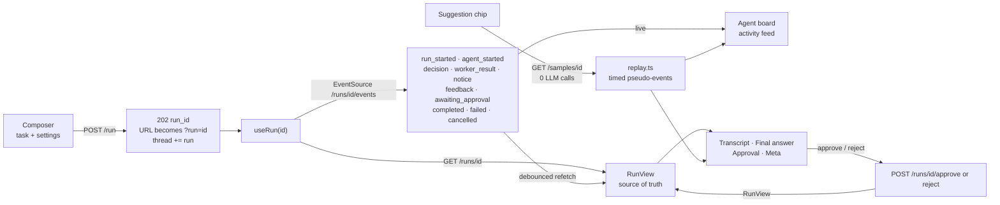

# Frontend Plan — Multi-Agent Research Assistant UI

Frontend design for [PLAN.md](PLAN.md). It consumes the backend API ([BACKEND_PLAN.md](BACKEND_PLAN.md), [backend/README.md](backend/README.md)), to be live at https://backend-production-13ec.up.railway.app. The stack and quality approach are the same as Labs 1–4. Two earlier UIs are the starting point: **Lab 4's chat** (composer, conversation turns, citations) and **Lab 3's live job view** (SSE stream, approval panel, replays). The new parts are the **agent board** (who is working now), the **transcript** of Supervisor decisions and worker results, and a **Markdown answer** with sources.

## 1. Scope

| Lab requirement | How it is met |
|---|---|
| Chat-like web interface to submit research tasks | A **conversation thread**: each task is a user bubble followed by the assistant's turn (status → final answer). A **composer** at the bottom (Enter sends, Shift+Enter adds a line), **run settings** (max iterations 1–8, require approval, use memory) and **suggestion chips** that are the stored samples |
| Real-time agent activity feed showing which agent is working | An **agent board**: one card per agent (Supervisor, Researcher, Writer, Reviewer, Fact-Checker) with its state (*idle · working · done · failed*, always as text), its current TASK and an elapsed timer, driven by the SSE events. Below it, an **activity feed**: one line per event ("Supervisor delegated to Researcher", "Researcher found 3 sources") |
| Conversation history showing Supervisor decisions and Worker results | A **transcript** per run, in order: each **decision** (iteration *n / limit*, REASON, `DELEGATE → worker` with its TASK, or FINAL; *repaired* and *forced* badges), each **worker result** (collapsible Markdown, cited sources, *unsourced* / *failed* badges; the Reviewer's verdict and issues; the Fact-Checker's claims table), **notices** and **human feedback** |
| Final output panel with formatted result | The final answer rendered as **Markdown** (headings, lists, tables), each `[n]` a link to its source, a **Sources** list with titles and domains, flags (*forced · degraded · unsourced · possible injection · redacted*), an "AI-generated" label, and *Copy* / *Download .md* |
| Responsive design | Wide screens: **thread** (left) and **activity panel** (right: agent board, feed, transcript). Phones: one column with tabs **Answer · Agents · Transcript** for the selected run. No horizontal page scroll at 375 px |

Extensions and Module 5 topics, made visible:

| Addition | Why |
|---|---|
| **Parallel workers**: two cards *working* at once; the decision shows "Reviewer + Fact-Checker in parallel" | Extension: parallel workers |
| **Approval panel**: at `awaiting_approval`, the draft answer with *Approve* and *Reject*; reject has a feedback box ("1 revision left"); a countdown to the 30-minute expiry | Extension: human approval |
| **Memory**: "Used memory from 2 earlier tasks" with links that open those runs in the thread | Extension: memory |
| **Fact-Checker** card and claims table (supported / unsupported / contradicted, as text) | Extension: more workers |
| **Service banner** from `/health`: *reduced* (Wikipedia down: answers are unsourced), *minimal* (daily quota used: samples only, countdown to the reset), *offline* (no answer from the server) | Course §1.4 graceful degradation |
| **Meta bar** per run: models, prompt version, calls (real / cached), tokens, **estimated cost**, duration | Course §2.3 cost management; §2.10 accountability |
| **Injection notice**: when the backend flags a task, the turn shows "Phrases often used in prompt-injection attempts were treated as data" | Course §2.1–2.2, made visible |
| **Try a sample**: the 3 stored real runs **replay** through the same components (agent board animates, transcript fills in) | A full demo with **0 LLM calls** |
| **Resumable run URL** `/?run=run_…` and a **thread kept in the browser** (`localStorage`, last 20 runs; reloading restores them from the API) | Runs take 20–60 s and can wait for approval; the thread survives a reload |
| **Friendly RFC 9457 errors** with a Retry-After countdown; **privacy notice** (tasks go to Google Gemini and Wikipedia; don't paste secrets) | As in Labs 2–4 |
| **Client-side checks** mirroring the backend (task 10–2,000 characters, iterations 1–8), with *Send* disabled and the reason shown | No request is wasted |

## 2. Stack

| Tool | Choice |
|---|---|
| Node | 24 (`nvm use 24`) |
| Framework | Next.js 16 (App Router), React 19, TypeScript strict, Tailwind v4 — same versions as Lab 4 |
| Validation | **Zod 4**: every API response **and every SSE event** is parsed with a schema mirroring the backend; invalid data is an error, never rendered half-valid |
| Live updates | Browser `EventSource` (named events, automatic reconnect with `Last-Event-ID`) — Lab 3's `events.ts` |
| Markdown | **`react-markdown` + `remark-gfm`** (tables, task lists). No `rehype-raw`: raw HTML in model output is never rendered (§5). Exact versions pinned at install |
| Tests | Vitest + Testing Library (unit, component) · Playwright with the installed Google Chrome (`channel: "chrome"`) + `@axe-core/playwright` |

Machine notes carried over (SESSION_CONTEXT §4, §10): `next dev` fails here (file-watch limit) → E2E uses `next build && next start`; `turbopack.root` in `next.config.ts`; Vite's native `resolve.tsconfigPaths`; read `node_modules/next/dist/docs/` before using a Next API (`searchParams` is a Promise).

**Reused, adapted:**

| From | What |
|---|---|
| Lab 4 | `lib/api.ts` (`request()` + Zod + `ApiError` kinds + Retry-After), `hooks/useApiError.ts`, `useCountdown.ts`, `useLoad.ts`, `useNow.ts`, `components/ask/Composer.tsx`, `TurnView.tsx` pattern, `lib/citations.ts` idea, `Badge`, `Tabs`, `ErrorBanner`, `PrivacyNotice`, `HealthDot`, `lib/format.ts`, Vitest / Playwright configs, E2E helpers |
| Lab 3 | `lib/events.ts` (EventSource wrapper, Zod per event, poll fallback), `lib/replay.ts` + `useReplay`, `ApprovalPanel`, `MetaBar`, the "RunView = source of truth, events = live hints" rule |

## 3. Layout

```
Wide (≥ lg)                                              Phone (375 px)
┌──────────────────────────────┬─────────────────────┐  ┌───────────────────────┐
│ Research Assistant   ● full  │  AGENTS             │  │ Research Assistant ●  │
│ privacy notice               │  [Supervisor] done  │  │ [Answer|Agents|Trans.]│
│                              │  [Researcher] work… │  │                       │
│  You: When should I use RAG… │  [Writer]     idle  │  │  You: When should …   │
│  ┌─ Assistant ─────────────┐ │  [Reviewer]   idle  │  │  Assistant: running…  │
│  │ ● Researcher working…   │ │  [Fact-Chk]   idle  │  │  ## Answer …  [1]     │
│  │ ## When to use RAG [1]  │ │  ACTIVITY (feed)    │  │  Sources              │
│  │ Sources · meta · flags  │ │  TRANSCRIPT         │  │                       │
│  └─────────────────────────┘ │   it1 DELEGATE …    │  │                       │
│ [suggestions]                │   Result researcher │  │                       │
│ [composer ……………… ] [Send]    │   …                 │  │ [composer] [Send]     │
└──────────────────────────────┴─────────────────────┘  └───────────────────────┘
```

The right panel shows the **selected** run: the newest one by default, or any turn the user clicks.

## 4. Structure

```
frontend/
├── app/                    layout.tsx · page.tsx (reads ?run=) · globals.css
├── components/
│   ├── ResearchApp.tsx         # client root: thread, selection, URL sync, health
│   ├── ServiceBanner.tsx       # full / reduced / minimal / offline (+ countdown)
│   ├── chat/
│   │   ├── Thread.tsx          # the turns (labelled section; a polite status line)
│   │   ├── Turn.tsx            # user bubble + assistant turn (status, answer, approval)
│   │   ├── Composer.tsx        # from Lab 4: textarea, counter, Send, disabled reason
│   │   ├── RunSettings.tsx     # iterations, approval, memory (collapsed summary line)
│   │   └── Suggestions.tsx     # sample chips (replay) + "Run it for real"
│   ├── activity/
│   │   ├── AgentBoard.tsx      # the five cards, from lib/agents.ts state
│   │   ├── AgentCard.tsx       # name, role, state text, TASK, timer
│   │   └── ActivityFeed.tsx    # event lines, newest last (scroll region)
│   ├── transcript/
│   │   ├── Transcript.tsx      # entries in order
│   │   ├── DecisionEntry.tsx   # iteration, REASON, DELEGATE/TASK or FINAL, badges
│   │   ├── ResultEntry.tsx     # collapsible worker output + sources + badges
│   │   ├── ReviewView.tsx      # verdict, issues (severity text), balance flags
│   │   └── FactCheckTable.tsx  # claims with status text
│   ├── answer/
│   │   ├── FinalAnswer.tsx     # Markdown + flags + Copy / Download + AI label
│   │   ├── Markdown.tsx        # react-markdown, safe components (§5)
│   │   └── SourceList.tsx      # n. title — domain (links)
│   ├── ApprovalPanel.tsx       # from Lab 3: draft, approve / reject + feedback, expiry
│   ├── MetaBar.tsx             # from Lab 3: models, calls, tokens, cost, duration
│   └── Badge · Tabs · ErrorBanner · PrivacyNotice   # from Lab 4
├── hooks/  useRun.ts · useReplay.ts · useThread.ts · useHealth.ts · useCountdown.ts · useApiError.ts
├── lib/
│   ├── schemas.ts     # Zod: RunView, TranscriptEntry, Accepted, Agent, Sample, Health, Problem, events
│   ├── api.ts         # startRun(), getRun(), approve(), reject(), agents(), samples(), sample(), health()
│   ├── events.ts      # subscribe(runId, handlers): EventSource, Zod per event, poll fallback
│   ├── agents.ts      # pure reducer: events or transcript → agent board state
│   ├── replay.ts      # stored RunView → timed pseudo-events
│   ├── citations.ts   # [n] → link to #source-n (Markdown text transform)
│   ├── thread.ts      # localStorage thread (run ids + tasks), defensive parsing
│   └── format.ts      # durations, costs, domains, relative times
├── tests/              unit + component (Vitest)
└── e2e/                Playwright
```

## 5. Data flow



- **The RunView is the source of truth; events are live hints** (Lab 3 rule).
  - `agent_started` updates the board immediately (the event has no entry to show).
  - `decision`, `worker_result`, `notice`, `feedback` carry the full transcript entry, so the transcript grows without a request; a **debounced refetch** (300 ms) of `GET /runs/{id}` follows terminal and approval events and keeps meta, sources and flags exact.
  - A terminal event closes the stream; the final RunView is fetched once more.
- **Agent board state** is a pure reducer (`lib/agents.ts`) over events. The same reducer runs over a stored **transcript** (reload, replay, a finished run), so the board is right however the page got there.
- **Reconnects**: `EventSource` resumes with `Last-Event-ID`. If the stream is closed for good, `events.ts` **polls** the RunView every 3 s until a terminal status, with a notice.
- **One active run at a time** in the UI (the server runs one at a time too): *Send* is disabled while a run is queued or running, enabled again on a terminal status or while awaiting approval.
- **Thread persistence**: `thread.ts` stores `{run_id, task, created_at}` for the last 20 runs. On load each one is fetched; `404` (deleted after 30 days) shows "This run is no longer available". Storage errors are ignored (private mode).
- **Replays**: a sample's transcript becomes timed pseudo-events (decisions and results about 700 ms apart; parallel results together). A badge says "Stored result — replay (0 LLM calls)"; approval buttons are hidden; "Run it for real" submits the sample task.

### Markdown safety (model output is untrusted)

| Rule | How |
|---|---|
| No raw HTML | `react-markdown` without `rehype-raw`, `skipHtml` on |
| Links | Only `http:` / `https:` (others rendered as text); `target="_blank" rel="noopener noreferrer nofollow"`; the domain is shown next to the link text |
| Images | Not rendered (alt text shown instead) — no tracking pixels from model output |
| Citations | `[n]` that matches a run source becomes a link to `#source-n` with `aria-label="Source n: Title"`; unknown numbers stay plain text |
| Code | Rendered as `<code>` / `<pre>` text; scroll boxes, never page overflow |

## 6. API client and errors

- `NEXT_PUBLIC_API_URL` is inlined at **build** time; default `http://localhost:8000`.
- Timeouts: **30 s** for every call (`POST /run` answers `202` at once; the work streams over SSE).
- Errors become `ApiError { kind, message, retryAfter?, fieldErrors? }`:

| Response | `kind` | Shown to the user |
|---|---|---|
| 400 `malformed-request` / 422 `validation-error` | `validation` | Field errors mapped to labels (`#/task` → "Task", `#/max_iterations` → "Max iterations") |
| 413 `input-too-large` | `too_large` | Problem `detail` (states the limit) |
| 404 `run-not-found` / `sample-not-found` | `not_found` | "This run is no longer available" / "Sample not found" |
| 409 `invalid-transition` | `conflict` | "The run already moved on" + refetch |
| 429 `rate-limited` | `rate_limited` | "You started too many runs — try again in N s" + countdown; *Send* disabled |
| 503 `llm-quota-exhausted` | `quota` | "Today's free AI quota is used up — samples still work" + countdown (hours shown as "about 5 h"); service banner → *minimal* |
| 503 `llm-unavailable` | `busy` | "The service is busy — try again in N s" |
| 504 `wait-timeout` | `server` | Not expected (the UI never uses `?wait=true`) |
| Other non-2xx | `server` | Generic message |
| `fetch` throws / timeout | `network` / `timeout` | "Can't reach the research service" / "took too long" |
| Body or event fails its Zod schema | `invalid_response` | "Unexpected response from the server" |

A **failure inside a run** is not an `ApiError`: the turn shows the run's `error` (`failed`), or the answer with a *forced* / *degraded* notice.

## 7. Backend additions needed (0 calls)

| Addition | Why |
|---|---|
| `GET /health` adds `limits: {task_min_chars, task_max_chars, default_max_iterations, max_iterations_limit, max_parallel_delegations, approval_timeout_min}` | The UI mirrors the server's limits instead of hard-coding them (Lab 4 had `/config` for the same reason) |

## 8. Accessibility and UX details

- **Thread**: a labelled `<section>`, not `role="log"` (Lab 4 lesson: a live log would read whole answers aloud). One **polite status** line announces changes, throttled: "Researcher is working", "Reviewer and Fact-Checker are working", "Answer ready, 3 sources", "Waiting for your approval".
- **Agent cards**: state as text + icon, never color alone; the working state has a subtle pulse that is **off** with `prefers-reduced-motion`.
- **Transcript entries** use `<details>`/`<summary>` for worker outputs (keyboard and screen-reader friendly); the latest entry is open.
- **Tabs** on phones follow the WAI-ARIA tabs pattern.
- **Scroll regions** (feed, transcript, code blocks, tables) have `tabIndex={0}`, `role="region"` and a label, and `position: relative` (Lab 3/4 lessons).
- **Busy states**: *Send* has `aria-busy` while posting; its disabled reason is visible text.
- **Contrast**: orange-700 / zinc-600 or darker on white; dark mode supported.
- **Long waits**: an elapsed timer and "iteration 2 of 5" so a 40 s run never looks stuck.

## 9. Quality strategy

| Level | What | Real LLM calls |
|---|---|---|
| Unit | `api.ts` (every row of §6, request shapes, Zod rejection), `events.ts` (parsing, terminal closes, invalid event, poll fallback), `agents.ts` (event and transcript reductions, parallel), `replay.ts`, `citations.ts`, `thread.ts` (limits, corrupt storage), `format.ts` | 0 |
| Component | C1–C14 below (api and events mocked) | 0 |
| E2E local | Real backend with **`LLM_MODE=fake`** and `FAKE_LLM_DELAY_S=0.3` (so the board visibly changes) + the production build of the frontend | **0** |
| E2E production | Sample replays, mobile, a11y, and **one** real run | ~7–8 (0 if the post-deploy run's answers are cached: same task, `use_memory=false`) |
| Also | `tsc`, ESLint, `next build`, coverage ≥ 80 % | 0 |

**Component tests**

| ID | Test |
|---|---|
| C1 | Initial render: composer with counter, settings summary ("5 iterations · approval off · memory on"), sample chips from `/samples`, agent cards from `/agents`, privacy notice; *Send* disabled with its reason until 10 characters |
| C2 | *Send* posts `{task, max_iterations, require_approval, use_memory}`, sets `?run=`, adds the user bubble and a running assistant turn; double submit blocked; *Send* disabled while running |
| C3 | Events drive the board: Supervisor working → done, Researcher working → done (3 sources), iteration counter; the feed lists each step; the status line announces |
| C4 | Parallel: one decision with two delegations shows both cards working at once and "in parallel" in the transcript |
| C5 | Transcript: decision entries (REASON, DELEGATE → worker + TASK, FINAL), *repaired* / *forced* badges, notices, collapsible results, reviewer verdict and issues, fact-check table with status text |
| C6 | Final answer: Markdown headings, list and table; `[1]` links to the source; sources list with domains; flags; meta bar (calls real / cached, tokens, cost); Copy and Download .md |
| C7 | Approval: draft + countdown; *Approve* → completed; *Reject* with feedback → feedback entry and "revising"; second reject → cancelled; 409 refetches |
| C8 | Memory: "Used memory from N earlier tasks" links open those runs in the thread |
| C9 | Sample chip replays the stored run (fake timers) without calling `startRun`; "Run it for real" submits it |
| C10 | Errors: 422 field error under the composer, 413 detail, 429 and 503 countdowns disable *Send* until 0, 404 on `?run=` shows "no longer available" |
| C11 | Service banner: *reduced* and *minimal* (with countdown, *Send* disabled) from `/health`; health failing → *offline* |
| C12 | Stream lost → poll fallback notice; the final state still renders |
| C13 | Thread: reload restores turns from `localStorage` (newest last, max 20); corrupt or blocked storage is ignored |
| C14 | Untrusted Markdown: `<script>`, raw HTML, a `javascript:` link and an image in an answer render inert (no element, no request) |

**E2E** (Playwright, installed Chrome, production build + fake backend)

| ID | Test |
|---|---|
| E1 | Type a task → the board shows each agent working in turn through real SSE → answer with sources; transcript has 4 decisions and 3 results |
| E2 | Approval on → pause → reject with feedback → revision → approve → completed |
| E3 | Reload with `?run=` and with the thread in storage → the same turns and transcript come back |
| E4 | Each sample replays its stored result (0 calls) |
| E5 | Errors: backend down (`page.route` abort) → network message; 429 with `Retry-After` (route mocked) → countdown |
| E6 | Mobile 375×667: no horizontal scroll; tabs Answer · Agents · Transcript work |
| E7 | axe: no serious/critical violations idle, running, awaiting approval and completed |
| E8 | Production: E4 + E6 + E7 + one real run against the live URLs |

## 10. Deployment (Vercel)

Requires the backend to be deployed first (API key set by you, `railway up`, post-deploy checks — pending).

```bash
cd TA_Module5/Lab_module5/frontend
vercel link --yes --project taller-research-agents
printf 'https://backend-production-13ec.up.railway.app' | vercel env add NEXT_PUBLIC_API_URL production
vercel --prod --yes
# then, from ../backend (redeploys the API with the new CORS origin):
railway variables --set "FRONTEND_ORIGIN=http://localhost:3000,https://<vercel-domain>"
```

**Post-deploy checks**: the page is public (200); the bundle contains the Railway URL (chunks under `/_next/static/immutable/chunks/`); CORS works from the Vercel origin for preflight, errors and the **SSE stream**; E8.

Vercel needs no secret: the Gemini key stays on Railway.

## 11. Implementation order

| # | Step | LLM calls |
|---|---|---|
| 1 | Backend: `limits` in `/health` (+ test). Scaffold from Lab 4 (Next 16, Tailwind, Vitest, Playwright, ESLint); `schemas.ts`, `api.ts`, `events.ts` + unit tests | 0 |
| 2 | `thread.ts`, `useThread`, `Composer`, `RunSettings`, `Suggestions`, `Thread`/`Turn` (C1, C2, C13) | 0 |
| 3 | `agents.ts`, `useRun`, `AgentBoard`, `AgentCard`, `ActivityFeed` (C3, C4, C12) | 0 |
| 4 | `Transcript` entries, `ReviewView`, `FactCheckTable` (C5) | 0 |
| 5 | `Markdown`, `citations.ts`, `FinalAnswer`, `SourceList`, `MetaBar` (C6, C14) | 0 |
| 6 | `ApprovalPanel`, memory links, `ServiceBanner`, errors (C7, C8, C10, C11) | 0 |
| 7 | `replay.ts` + `useReplay` (C9); responsive tabs and a11y pass | 0 |
| 8 | E2E E1–E7 against the fake backend | 0 |
| 9 | Deploy to Vercel, CORS on Railway, E8, `DEPLOY.md`, README | ~0–8 |

## 12. Definition of done

- [x] Every lab frontend requirement (§1), including the 4 extensions visible in the UI
- [x] typecheck, lint, 45 unit/component tests (95 % lines), build: 0 LLM calls
- [x] E1–E7 pass locally against the fake backend (6 tests)
- [x] Deployed to Vercel (https://taller-research-agents.vercel.app); CORS updated on Railway; production subset 3/3 incl. E8 (0 real calls, 8 cached)
- [x] `frontend/DEPLOY.md` with the steps run; `frontend/README.md`; plans updated (§13)

## 13. Implementation notes (deviations from this plan)

Implemented: typecheck and ESLint clean, **45 unit/component tests (95 % lines)**, **6 E2E tests** against the fake backend (axe clean on idle, running, awaiting approval, completed and phone), production build. The backend addition (§7, `limits` in `/health`) is deployed.

| Plan | Implementation | Why |
|---|---|---|
| `useRun` + `useReplay` | One `useRun(source)` with `source = live run id \| stored run to replay` | Live events and replay frames go through the same reducer and view updates |
| A hook per thread turn | Only the **last** run is followed live (SSE); earlier runs are fetched once | Matches "one active run at a time"; no idle streams |
| `useThread` with `useState` + effect | An external store read with `useSyncExternalStore` | No hydration mismatch (the server renders an empty thread) and no setState in an effect (React 19 lint) |
| Separate files for `DecisionEntry`, `ResultEntry`, `AgentCard`, `SourceList`, `Thread` | Kept inside `Transcript.tsx`, `AgentBoard.tsx`, `FinalAnswer.tsx`, `ResearchApp.tsx`; `ReviewView` + `FactCheckTable` in `transcript/WorkerData.tsx` | Each is a few lines; fewer files |
| Lab 4 `Tabs` component | A small tablist shown below `lg` only; panels are hidden by CSS | The panels are laid out side by side on wide screens: one DOM, no duplicate content |
| `next build` checks the whole project | `tsconfig.build.json` (no `tests/`, `e2e/`) via `typescript.tsconfigPath` | The first Vercel build failed: test fixtures import `../backend/samples/`, which Vercel doesn't upload |
| E1 waits for each card to show *working* | E1 checks *working* once, then the feed's "started" / "finished" lines | The backend's SSE loop polls every 0.5 s and the fake agents answer in 0.3 s, so a short *working* state can arrive together with its result. With real calls (seconds each) every state is shown |

**Bugs found by the tests and fixed:**
- **`[1][2]` left the first citation unlinked (unit test).** The "already a link" lookahead also skipped `[1]` followed by `[`. Real Gemini answers use adjacent citations, so this would have shown in production.
- **`?run=` could erase the saved thread (review).** During hydration the first render's thread is the empty server snapshot; the mount effect now reads the store directly.
- **`Date.now()` during render (ESLint `react-hooks/purity`).** The quota-reset deadline is computed when `/health` answers.
- **Activity feed did not follow the newest line, and the "Selected run" line showed under the phone's Answer tab** (manual check in Chrome).
- **E2E SQLite WAL files (`.db-shm`, `.db-wal`) were committed.** Removed and ignored (`.gitignore`).

